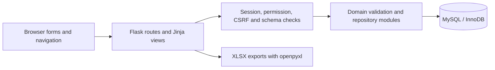
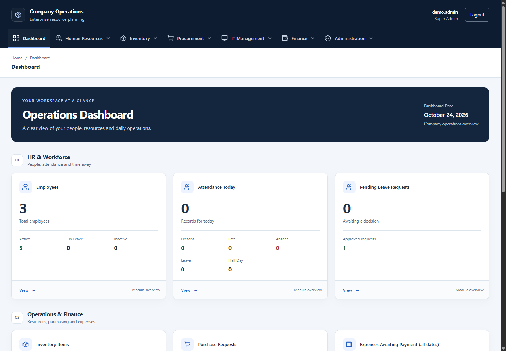
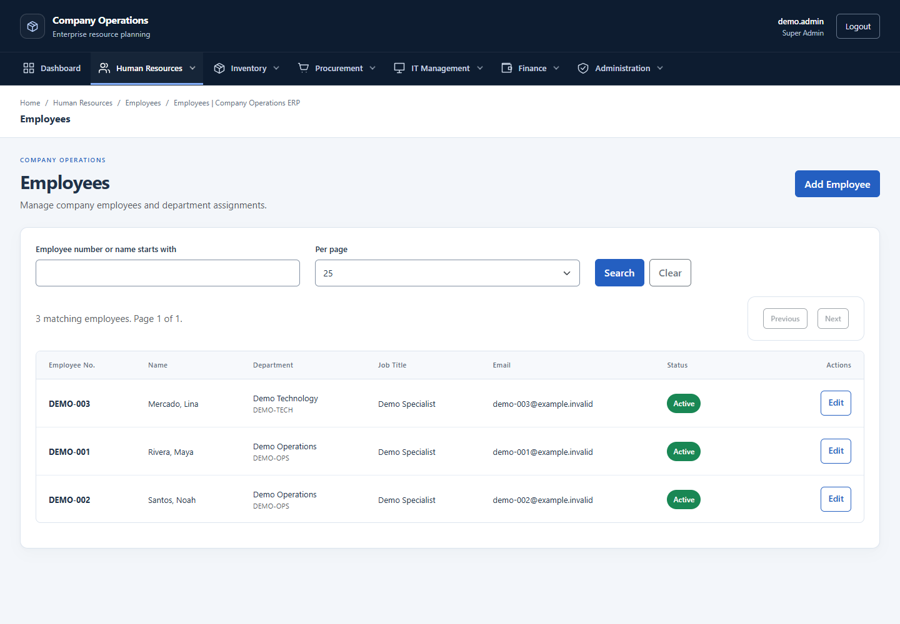
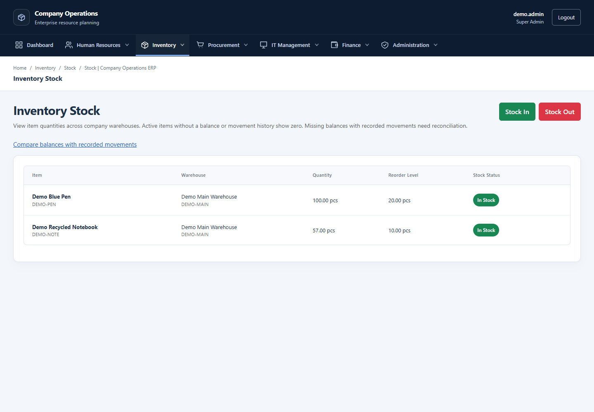
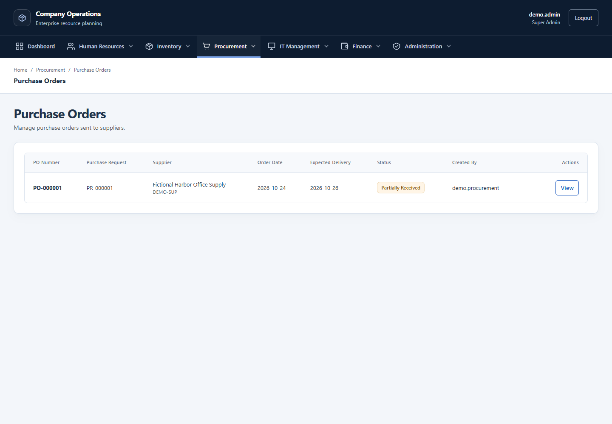
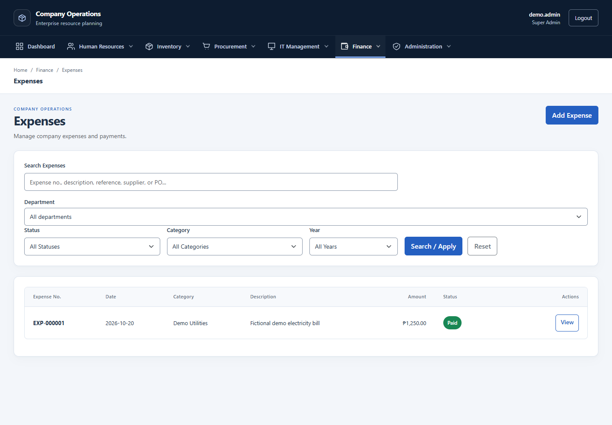

# Company Operations ERP v1.0

A Flask and MySQL portfolio project for managing people, purchasing, inventory,
finance and internal support in one permission-controlled workspace. The system
connects operational records through validated workflows, relational constraints
and transactional updates, with a responsive navy/slate interface.

**Scope:** a locally verified portfolio demo using fictional data. Readiness for
synthetic demonstrations, internal pilots and production is assessed separately.
This project is not production-certified or represented as a commercial deployment.

## Overview

Company Operations ERP demonstrates how common back-office processes can share
master data while retaining module-specific validation and access controls. A
purchase request can become a purchase order and a partial goods receipt that
updates stock; department budgets constrain expense payments; attendance and leave
feed monthly Payroll calculations with saved freshness evidence.

The emphasis is on traceable business state, safe failure handling and consistent
forms, tables, filters and navigation across modules.

## Implemented features

| Module | Implemented capabilities |
| --- | --- |
| Dashboard and Administration | Permission-aware operational summaries; user accounts, roles, permission assignments and active-status management. |
| Human Resources | Departments, employee records, filters and revision checks that reject stale concurrent edits. |
| Attendance and Leave | Attendance recording, leave types, requests, approval, balances and reports. |
| Payroll | Compensation, periods, generated entries, monthly calculation, adjustments, submit/return/approve/pay workflow, paid payslips and reporting. |
| Inventory and Warehouses | Categories, item catalog, warehouses, stock in/out, movement history, reconciliation and reporting. |
| Procurement | Suppliers, purchase requests and line items, approvals, purchase orders, and partial/full receiving connected to inventory. |
| Finance | Expense categories, expenses, department budgets, approvals, budget-checked payments, reports and spreadsheet exports. |
| IT Asset Management | Asset registration, custody assignments, return, maintenance, lifecycle history and reporting. |
| Help Desk Ticketing | Ticket creation, assignment, progression, resolution, closure and histories. |
| Audit Logging | Central audit viewing and filtering, with business-action events and module-specific transaction histories. Central audit persistence is best effort. |

Payroll salary/cutoff/pay-type and employment lifecycle policies require separate
owner acceptance before any real salary processing. See the
[known issues and decisions](ERP_V1_KNOWN_ISSUES.md).

## Technology stack

| Layer | Technology |
| --- | --- |
| Application | Python 3.14, Flask, Werkzeug and Jinja templates |
| Data | MySQL 8.0.16+ with InnoDB, enforced CHECK constraints and mysql-connector-python |
| Interface | Server-rendered HTML, Bootstrap 5.3.8, custom CSS and JavaScript |
| Request security | Flask-WTF CSRF protection and Flask signed sessions |
| Spreadsheet exports | openpyxl |
| Verification | Python unittest, Node 24 navigation/CDP checks and GitHub Actions |

Application dependencies are pinned in [requirements.txt](requirements.txt).
Local release checks used Windows and MySQL Community 8.0.46; exact versions and
coverage are recorded in the [release test report](ERP_V1_TEST_REPORT.md).

## Architecture

The application is server-rendered. Flask routes coordinate request security,
domain validation and repository modules; repositories execute SQL against
MySQL. Jinja renders HTML, with shared CSS/JavaScript providing the browser interface.



- [app.py](app.py) defines routes and coordinates module actions.
- [security.py](security.py) and [csrf_security.py](csrf_security.py) enforce
  sessions, authorization and unsafe-method protection.
- [database.py](database.py), [schema_gate.py](schema_gate.py) and
  [schema_compatibility.py](schema_compatibility.py) enforce database readiness.
- Repository and validation modules keep business checks and SQL operations
  outside the templates. InnoDB transactions, row locks, Decimal arithmetic and
  unique submission identifiers protect the workflows that use them.
- [templates](templates), [static](static), [database](database) and [tests](tests)
  contain the interface, schema/migrations and verification suites.

## Screenshots

These screenshots show the running local ERP with fictional portfolio-demo data.
They were captured at a 1440 × 1000 viewport using the synthetic Super Admin
account; available actions depend on the signed-in user's permissions.

**Dashboard** — Workforce indicators and the start of the operations overview.
Zero counts reflect the existing demo data on the capture date.



**Human Resources** — Fictional employees, department assignments and employment status.



**Inventory** — Existing demo item balances, warehouse assignments and reorder levels.



**Procurement** — A synthetic purchase order in its existing partially received state.



**Finance** — Expense filters and a fictional paid electricity bill.



The [portfolio screenshot plan](docs/PORTFOLIO_SCREENSHOT_PLAN.md) documents the
page selection, fictional-data safeguards and review criteria for further captures.

## Authentication and access control

Users sign in through a CSRF-protected login form. Server-side permission checks
protect routes, and the navigation/dashboard reflect the current account's access.
Committed account, role and permission changes are rechecked on the next request.

The role seed defines Super Admin, HR Manager, Inventory Manager, Procurement
Manager, IT Manager, Finance Manager and Employee. Permissions are configurable;
role names alone do not guarantee a fixed entitlement set. The
[route/permission inventory](docs/ERP_V1_ROUTE_PERMISSION_INVENTORY.csv) and
[IT authorization contract](IT_AUTHORIZATION.md) describe the implemented boundaries.

There are no published default login credentials. Demo passwords and signing keys
belong in local secret configuration and must remain outside Git and screenshots.
Session expiry, revocation limits and deployment requirements are detailed below.

## Database design and migrations

The relational schema links employees and departments, users and role permissions,
stock and movements, purchasing documents, budgets and expenses, and Payroll
records. Foreign keys, unique constraints, enforced CHECKs and transaction-level
validation complement the application checks.

Schema installation and upgrades are explicit operator actions. Review the
[SQL definitions and migrations](database/migrations/README.md) before execution:

- 001 and 002 protect receiving and manual stock submissions against duplicate replay.
- 003 supplies the reviewed IT/Help Desk permission mappings.
- 008 independently verifies/upgrades Employee and Department revision structures.
- 010 adds Attendance/Leave/Payroll coordination and saved calculation evidence.

Fresh schema definitions include current structures; `CREATE TABLE IF NOT EXISTS`
does not upgrade an older table. Startup never applies migrations or repairs a
schema. Missing/incompatible structures can reject database-backed requests,
including login, with HTTP 503. `/health/live` and `/health/ready` distinguish
process liveness from database readiness.

Use a separately provisioned synthetic database for demonstrations. Several SQL
files contain a hardcoded original database name: review controlled copies, remove
unapproved CREATE DATABASE/USE statements and reject remaining original-target
references before executing any setup. Keep schema setup privileges separate from
least-privilege runtime credentials. Never initialize or seed an existing company
database as a shortcut. DDL implicitly commits; deployment/rollback requirements
remain mandatory even for additive migrations.

## Automated testing and CI

The merged main commit `3a652a17333856deb3bae11d02375dc93dd7df20` passed
[ERP CI run #49](https://github.com/pauljohnsuela64-prog/Company-Operations-ERP/actions/runs/40077433227)
with **zero annotations**:

| Check | Verified result |
| --- | --- |
| Python unit tests | 544 passed |
| JavaScript navigation tests | 11 passed |
| Disposable MySQL integration | 38/38 suites passed |
| Dependency and Python/Jinja/JavaScript syntax checks | Passed |

These results apply to the linked commit and the checks listed above.
The [CI annotation investigation](docs/CI_ANNOTATIONS_RUN_47.md) explains the
preceding test-isolation fix without any change to the database guard.

After installing dependencies, the repository checks can be run with:

```powershell
.venv/Scripts/python.exe -m pip check
.venv/Scripts/python.exe -B -m unittest discover -s tests -q
node --test tests/horizontal_navigation.test.cjs
.venv/Scripts/python.exe -B scripts/ci_checks.py python
.venv/Scripts/python.exe -B scripts/ci_checks.py javascript
.venv/Scripts/python.exe -B scripts/ci_checks.py mysql
```

MySQL runners create `--no-defaults` servers on dynamic loopback ports, verify
selected datadir and held-child PID, seed synthetic records and stop only their
own server. They do not use company settings in `.env`. Investigate identity or
cleanup failures; never fall back to an existing server. `scripts/ci_checks.py mysql`
accepts `--mysqld` for an explicit installed executable, never a database endpoint.
Node navigation/CDP checks have no npm dependencies.

Separate explicit release checks include:

```powershell
.venv/Scripts/python.exe -B tests/mysql_payroll_freshness_audit.py
.venv/Scripts/python.exe -B tests/mysql_release_rehearsal.py
.venv/Scripts/python.exe -B tests/mysql_payroll_freshness_browser.py
```

Visual/accessibility suites require `ERP_GUI_BOOTSTRAP_CSS` pointing to trusted
local Bootstrap 5.3.8 CSS; visual suites also use `ERP_GUI_SCREENSHOTS`. They serve
that cached CSS and block other external resources. See the test report for browser
commands and coverage. The synthetic root/no-password connections and fixture
passwords in disposable tests are test-only. Do not run setup/connection-check
scripts against workstation defaults as a substitute for isolated tests.

## Installation and local demonstration

For a fresh development environment on Windows:

```powershell
py -3.14 -m venv .venv
.venv/Scripts/python.exe -m pip install -r requirements.txt
.venv/Scripts/python.exe -m pip check
```

Persistent demo provisioning is a separate, explicitly authorized operator step:
verify a new empty synthetic database, review the schema and migrations, configure
a database-scoped runtime account, and create fictional users through the supported
bootstrap workflow. The disposable test runners demonstrate reproducible setup;
they are not a production provisioning tool.

Review [.env.example](.env.example) as a variable reference, not as a ready-to-use
database target. Never overwrite an existing `.env`. A separate `.env.demo` can be
loaded with the Flask CLI after its target and secrets have been reviewed. Ensure
`.env.demo`, `.demo-users.json` and other private files are ignored before creating
them; use local `.git/info/exclude` or approved ignore rules and verify with
`git check-ignore`. Do not commit credentials or reuse test fixture passwords.

For an **already provisioned and compatible** local demo named
`company_operations_erp_demo`, use the following in a dedicated PowerShell terminal.
These non-secret target settings override inherited company database selections.
The private `.env.demo` must contain the runtime `DB_PASSWORD` and a stable
`SECRET_KEY`; confirm both are present before launching:

```powershell
$env:DB_HOST = '127.0.0.1'
$env:DB_PORT = '3306'
$env:DB_USER = 'erp_demo_app'
$env:DB_NAME = 'company_operations_erp_demo'
$env:ERP_ENV = 'development'
$env:ERP_DEBUG = 'false'
.venv/Scripts/python.exe -m flask --env-file .env.demo --app app --no-debug run --host 127.0.0.1 --port 5000 --no-debugger --no-reload
```

Existing environment values take precedence over dotenv files. In this dedicated
terminal, ensure inherited `DB_PASSWORD` and `SECRET_KEY` values are either absent
or match the reviewed demo configuration. Open
[the local login page](http://127.0.0.1:5000/login), then check `/health/live` and
`/health/ready` return 200. Keep existing working demo data and configuration;
there is no need to rerun migrations or seeding for a README update.

Flask's development server is suitable only for an isolated local target. The
security and deployment requirements below apply before any wider use.

## Security and integrity contracts

Supply SECRET_KEY and DB_HOST/DB_PORT/DB_USER/DB_PASSWORD/DB_NAME explicitly.
ERP_ENV defaults to development; production must be explicit with ERP_DEBUG=false.
Production startup rejects missing/example/short signing keys and debug mode;
minimum length does not prove entropy. All workers need one stable secret and
synchronized clocks. Never put secrets or company data in Git.

Signed sessions use an HMAC credential marker rather than exposing password hashes.
Committed password/role/permission/active-status changes apply on the next request;
this is not retroactive cancellation of an in-flight authorized transaction.
Defaults: 30-minute idle and eight-hour absolute expiry, configurable via
ERP_SESSION_IDLE_SECONDS and ERP_SESSION_ABSOLUTE_SECONDS. Cookies are
HttpOnly/SameSite=Lax; production enforces Secure.

CSRF protects unsafe methods including login/logout. GET logout is confirmation;
POST requires a token. One-hour tokens support explicit signed expired-form
recovery without automatic business replay. Permitted values/UUIDs are retained;
password/secret/file forms do not receive payload-preserving recovery. Receiving
UUIDs and CSRF tokens serve different purposes: reconciliation retains the original
receiving identity and must not replay an uncertain payment or delivery automatically.

Explicit migration 010 adds durable Attendance generations and saved calculation
evidence under a shared Attendance/Leave/Payroll transaction guard. Stale/unknown
submit/approve/pay rejects; legacy evidence is not fabricated, APPROVED is not
automatically reopened and PAID history is preserved. Missing/incompatible structures
can block database-backed requests application-wide, including login. Startup never
automatically runs migrations.

Known limits: no per-device server-side session revocation, no automatic login rate
limiter/MFA, best-effort central audit durability, pinned external CDN CSS, and no
physical-device/full WCAG/production-capacity certification. See the known-issues
register for sensitive-data, authorization, deployment and policy boundaries.

## Deployment and release evidence

Do not expose Flask's development server/debugger publicly. An approved WSGI host,
verified TLS/proxy/host controls, managed secrets, least-privilege DB credentials,
backups/restore, monitoring and owner UAT are prerequisites. ProxyFix trust,
HSTS/CSP and public host controls are not enabled automatically. Production Secure
cookies do not work over plain HTTP.

Migration 010 requires approved backups, drained writers, schema validation,
explicit migration, coordinated worker deployment, readiness proof and deliberate
resumption. Mixed old/new/direct SQL writers are unsupported. DDL implicitly commits;
old-code rollback forfeits the new guarantee. APPROVED recovery, PAID correction,
salary/lifecycle, PR self-approval and historical UOM remain owner decisions.

- [Release readiness](ERP_V1_RELEASE_READINESS.md)
- [Final test report](ERP_V1_TEST_REPORT.md)
- [Known issues and decisions](ERP_V1_KNOWN_ISSUES.md)
- [Deployment checklist - not authorization](ERP_V1_DEPLOYMENT_CHECKLIST.md)
- [Development changelog](ERP_V1_CHANGELOG.md)
- [Progress and workflow matrix](ERP_V1_RELEASE_VERIFICATION_PROGRESS.md)
- [Route/permission inventory](docs/ERP_V1_ROUTE_PERMISSION_INVENTORY.csv)
- [Payroll freshness](PAYROLL_ATTENDANCE_FRESHNESS.md)
- [Migrations](database/migrations/README.md)
- [CI and focused tests](tests/README.md)

CI runs Python tests/syntax/dependencies, JavaScript syntax/navigation and discovered
MySQL smoke suites. Chrome/Edge visual/accessibility checks, the explicit original
freshness audit and new backup/restore rehearsal are separate local checks. Green
CI does not certify those checks or authorize deployment, release tags or company
migrations.
